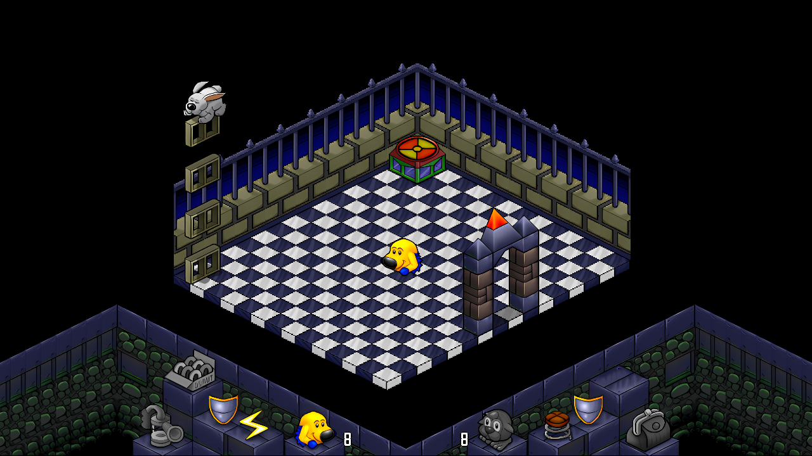
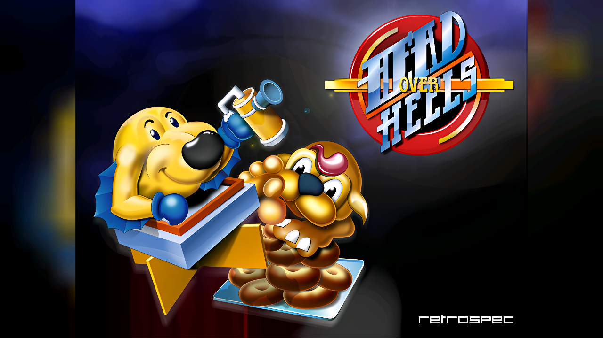
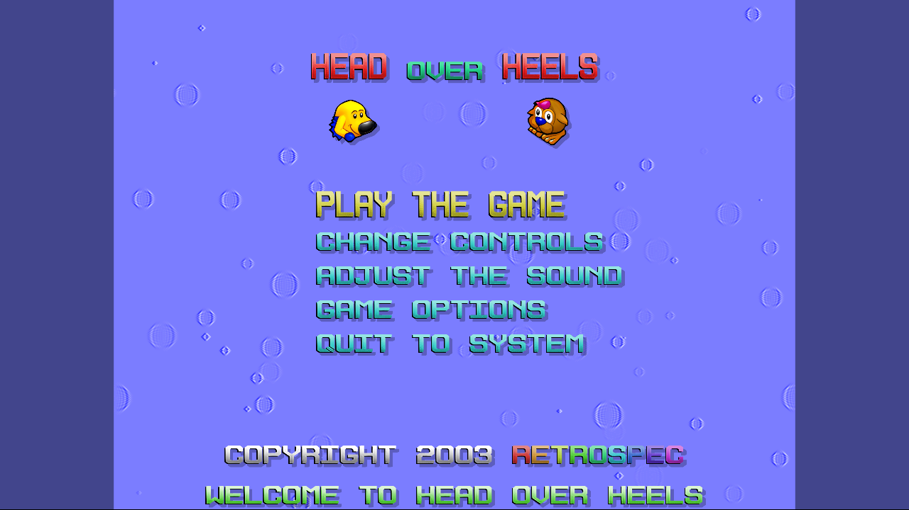
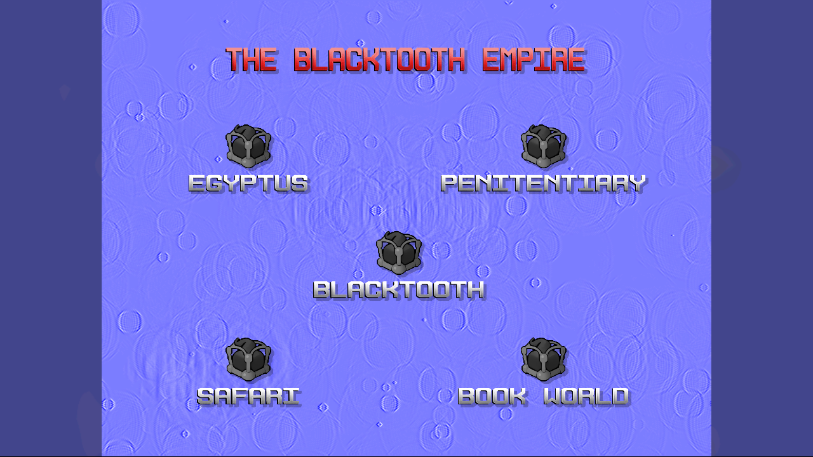
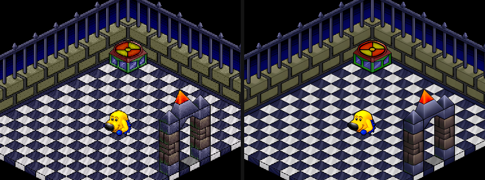
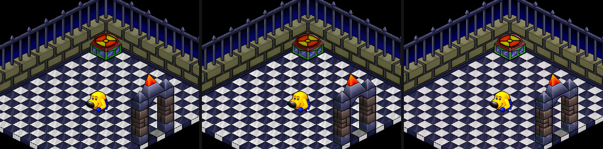
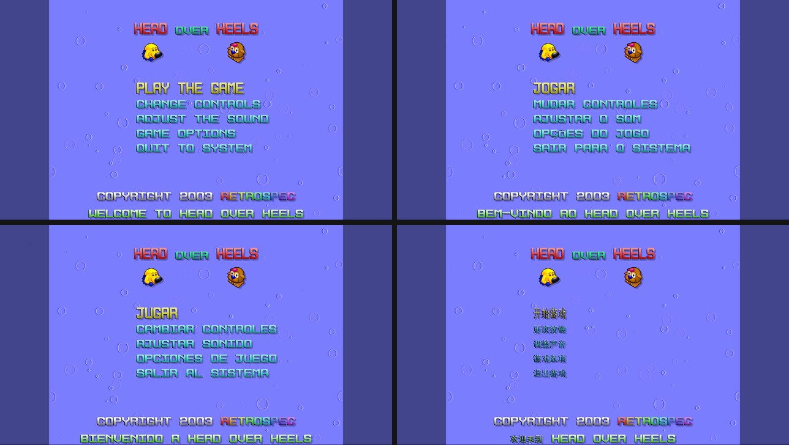
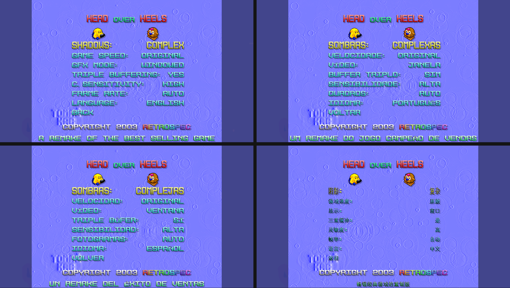

# Head Over Heels — native port

[English](#english) · [Português](#português)



## English

Native port of **Head Over Heels** (the 2003 Retrospec remake) to Windows 10/11 x64,
Linux x86_64 and Linux aarch64 (R36S handheld), in C++17 + SDL2.

The port **ships no game files**: it reads the user's own original data
(`HoHOriginal.dat`, `Sound/Sound.dat`, `Sound/Theme.ogg`, `Sound/Game.ogg`).
The reverse-engineering notes (file formats, executable map, decompilation) live outside this
repository (`../HeadOverHeels/re/`: `FORMATOS.md`, `PLANO_PORT.md`).

### Screenshots

| | |
|---|---|
|  |  |
| Title screen (HD pack, 16:9 responsive mode) | Main menu |
|  |  |
| Planet map | In game: the room uses the extra width, the HUD runs to the edges |

Original pixels (left) and HD pack (right), same frame:



The three HD packs (Real-ESRGAN `anime`, `x4plus` and `animevideo`), switched in game with **F8**:



Languages (English, Portuguese, Spanish, Chinese) — main menu and GAME OPTIONS:





### Status

Milestone 1 — foundation:

- `src/compat/`: the subset of Allegro 4.0 that `HoH.exe` uses (67 functions), with the same
  semantics, so the decompiled logic can be ported almost line by line.
  - dependency-free core: RGB565 bitmaps, blit/masked_blit/stretch_sprite, FBlend (trans/add),
    debug font, packfiles (`19h28o37h` cipher + LZSS, reading and writing compatible with the
    original game), datafiles;
  - SDL2: window/fullscreen with 4:3 scaling, keyboard with Allegro 4.0 `KEY_*` numbering,
    controllers (`joy[]` in Allegro's layout), threaded timers like Allegro, a voice mixer and
    Ogg music (vorbisfile) instead of alogg.
- `src/data/`: reader for `HoHOriginal.dat` (all graphics) and the 276 rooms.
- `src/main.cpp`: a viewer (title screen, music, sprites, sounds) to validate the above.
- `tests/datatest.cpp`: checks the reader against the original files.

Milestone 2 — original front end ported (`src/game/`): `game_main` and the fixed-step loop
(30 ticks/s), intro, title screen, menus, water background, transitions, bitmap fonts, HSL
recoloring, sound effects, music, `Config.dat` compatible with the original.

Milestone 3 — **isometric engine and gameplay ported**: the 308 game functions of `HoH.exe` are
in C++ (each with its original address in a comment), split into modules: `engine_data` (blocks,
floors, walls, worlds), `room_load` (`load_room` reading the original blob), `room_render`
(isometric projection, occlusion, shadows, lighting), `physics` (collision, gravity, pushing,
conveyor belts), `controllers` (the 22 object behaviours), `gameplay` (`update_state_game`, room
changes, Head/Heels, items) and `screens` (HUD, planet map, pause, game over, `Save%i.dat` saves
compatible with the original). Types in `engine_types.h` follow the verified original layout
(32-bit offsets). Sending high scores to Retrospec's (defunct) server never opens a connection.

On top of the original game, the port adds smooth motion (60/120 fps), HD sprite packs, a
responsive widescreen/portrait mode and four languages (sections below).

Next: play through the whole game and fix differences; a Web (WebAssembly) build.

### Building (Linux / WSL)

```bash
sudo apt install -y cmake ninja-build libsdl2-dev libvorbis-dev
cmake -S . -B build/linux -DHOH_DATA_DIR=/path/to/HeadOverHeels
cmake --build build/linux -j
ctest --test-dir build/linux        # checks the reader against the original data
./build/linux/hoh --data /path/to/HeadOverHeels
```

Core and test only (no SDL): `-DHOH_BUILD_GAME=OFF`.

Shortcuts: `scripts/build-linux.sh [game_dir]` (configures, builds and runs the test),
`scripts/game-smoke.sh [game_dir]` (runs the game headless with scripted keys and saves
screenshots to `build/game-smoke/`), `scripts/smoke-test.sh` (same for the viewer),
`scripts/check-syntax.sh [files]`, `scripts/play-test.sh` (NEW GAME → first room → walk/jump) and
`scripts/monkey-test.sh <data> <seed> <n> game` (ASan/UBSan, random keys while playing).

Executables: `hoh` (the game) and `hoh-viewer` (the milestone 1 sprite/sound viewer).

Automated testing (environment variables): `HOH_KEYS="3000:ENTER;6500:DOWN"` presses keys,
`HOH_SHOTS="5000:screen.bmp"` saves the frame, `HOH_AUTOQUIT_MS=12000` quits.

### Building for Windows x64 (in WSL, with MinGW-w64)

```bash
sudo apt install -y mingw-w64 ninja-build cmake
scripts/build-windows.sh            # builds SDL2/libogg/libvorbis and produces dist/windows/
```

The script expects these in `/mnt/f/headover/tools/deps/dl/` (or in the folder given as an
argument): `SDL2-devel-2.32.10-mingw.tar.gz` (github.com/libsdl-org/SDL), `libogg-1.3.5.tar.gz`
and `libvorbis-1.3.7.tar.gz` (downloads.xiph.org, with xiph's `SHA256SUMS`). `hoh.exe` has the
GCC runtime built in and only needs `SDL2.dll` next to it. `dist/windows/` also contains
`Jogar.bat` and `LEIA-ME.txt`.

### Building for the R36S (aarch64, ArkOS) — in WSL, with Zig

```bash
scripts/build-r36s.sh               # produces dist/r36s/ports/ and dist/hoh-r36s.zip
```

Uses Zig 0.14.1 (`~/tools/zig-x86_64-linux-0.14.1/zig`, ziglang.org) targeting
`aarch64-linux-gnu.2.28`: the binary needs at most GLIBC_2.17, has libc++ built in and uses the
device's own `libSDL2-2.0.so.0` (KMSDRM). libogg/libvorbis are linked statically. For linking, the
script generates an SDL2 stub with the same soname from the WSL headers.

Installing on the device: extract `hoh-r36s.zip` into the card's `roms/` folder (giving
`roms/ports/Head Over Heels (Nativo).sh` and `roms/ports/hohnative/`), copy `HoHOriginal.dat` and
the `Sound/` folder to `roms/ports/hohnative/gamedata/` and launch it from Ports. Controls go
through gptokeyb (`hohnative/hoh.gptk`, same mapping as the Box64 port); SELECT+START quits. Log in
`roms/ports/hohnative/log.txt`. On the device FRAME RATE defaults to AUTO, as on PC: 60 frames
per second (tested: smooth), dropping to 30 by itself if it can't keep up; 30 FPS in
GAME OPTIONS → FRAME RATE matches the original.

### Image quality (PC)

The game draws at 640×480; the port scales it to the window/full screen keeping 4:3
(`src/compat/video_scaler.cpp`). **F10** cycles the mode, which is saved in `port.cfg`
(or `HOH_SCALER=...`):

| Mode | Result |
|---|---|
| `smooth3x` (default) | smoothed edges (Scale3x/AdvMAME3x) + filtering |
| `smooth2x` | same with Scale2x/EPX |
| `sharp` | crisp, even pixels at any size (integer prescale + filtering) |
| `nearest` | raw stretched pixels |
| `integer` | integer multiples only, with borders |

The window opens at ~90% of the screen height. On the R36S (640×480 screen) the image is always 1:1.
Headless test: `scripts/scaler-test.sh` (captures the scaled output of each mode).

### Smooth motion

The logic runs at 30 steps per second (60 in the menus), as in the original. In game, with smooth
motion, each frame shows positions interpolated between the previous and the current step (the
picture runs one step behind the logic); after drawing, everything goes back to the real state,
including the `rand()` seed, so gameplay doesn't change.

Frames are produced at the monitor's refresh rate divided by an integer, so each frame stays on
screen for the same time: on a 120 Hz monitor, 120 or 60 per second; on a 144 Hz one, 144 or 72.
Choose in GAME OPTIONS → FRAME RATE (a port item, before BACK; left/right) or with **F9**; it is
saved in `port.cfg` as `fps = ...` (or `HOH_FPS=auto|120|60|off`):

| Mode | Result |
|---|---|
| `auto` (default) | monitor rate; if the PC misses more than 10% of the refreshes, it drops to half and tries again later |
| `120`, `60`… | fixed (rounded to a divisor of the monitor rate) |
| `off` | only the original 30 frames |

With vsync, present waits for the refresh and, in half mode, the same frame is presented twice.
If vsync doesn't hold (driver forcing it off, software renderer), the port notices the frames
aren't landing on the refresh grid and paces itself with the clock instead. `HOH_SHOW_FPS=1`
shows the counter; `HOH_PROFILE=file` records the pacing every second (monitor rate, target,
vsync, missed refreshes, work time per frame) and the loop timings, with the worst frame of each
second; `HOH_REFRESH=N` pretends the monitor runs at N Hz (for tests).

### HD graphics (PC)

Upscaled sprite packs replace the game's graphics with HD versions, without changing gameplay,
on every screen: intro, title, menus, planet map, game, pause and results.
The game still draws the 640×480 frame exactly as before; every draw call is recorded into a list
(`src/compat/hd_core.cpp`) and, at present time, the list is replayed on the GPU
(`hd_render.cpp`) with the pack's images at the pack's native resolution (2560×1920 for 4× packs),
then scaled down to the window. **F8** cycles off → each pack; it is saved in `port.cfg`
(`hd = <pack>|off`, or `HOH_HD=...`).

- Packs: `<data folder>/hd/<pack>/<name>.qoi` (or `HOH_HD_DIR`), one file per image in
  `HoHOriginal.dat`, named as exported by `re/tools/hohfmt.py` (`block000_d0_f00_a`,
  `mobile000_f00`, `named_000_Dungeon_f00`, `world0_main`, `image00_48x29`...). A missing image
  falls back to the original, unfiltered.
- Floors and walls are cut out of the file's images (16 px tiles, 8×12 cells): the port runs the
  same cut over coordinate images to learn where each pixel came from, and builds the HD tile
  from the matching blocks (`src/game/hd_assets.cpp`).
- Objects: the game doesn't depth-sort, it clips each object wherever another one is in front.
  The HD renderer draws whole frames in the order given by those clips.
- Screens outside the game: the work bitmaps (menu panel, text line, logo, copyright, ticker,
  tinted fonts, `g_buffer2` holding the frame for pause and transitions) have their own lists,
  which start at a `clear_to_color` or at a draw that covers the whole bitmap. When one of them is
  drawn onto another, its draws are inlined into the destination list (when the result is the
  same) or it becomes its own GPU texture (stretched menu line, fading panel, darkened game frame).
  Font HSL tinting (`tint_bitmap`), shadow silhouettes and grayscale are transforms applied to the
  pack's texels. The menu water is a filtered 1x copy of the frame; the column transition copies
  the old frame once per step.
- On the R36S (and on PC without packs) nothing is recorded.
- Making packs (scripts in `HeadOverHeels/re/remaster`, outside this repository because they use
  the game's graphics): `hohfmt.py sprites` → `upscale.py` (Real-ESRGAN ncnn-vulkan, 4×, keeping
  transparency) → `make_qoi.py`. Packs are derived from the game: do not redistribute them.
- Tests: `scripts/hd-tour.sh` draws all 276 rooms and checks that the list reproduces the 1x
  frame pixel for pixel (currently: 0 differences); `scripts/hd-states.sh` goes through the
  intro, title, menus, map, game, pause and results with scripted keys and requires 0 differing
  pixels in every state (currently: 0). `HOH_HD_VERIFY=file` does the same check while playing,
  per state, every 30 frames (`HOH_HD_VERIFY_EVERY=n`); with `HOH_HD_VERIFY_DEEP=1` it also
  checks each source list when it is used. `HOH_TEST_GAMEOVER_MS=t` sends the game to the results
  screen at time t (for tests).

### Responsive mode (PC)

The picture follows the window's aspect ratio in real time: the shorter side stays fixed (480
lines tall in landscape, 640 columns wide in portrait) and the other grows with the window — 16:9
gives 854×480, 21:9 gives 1120×480, portrait up to 640×854; at 4:3 it's the usual 640×480.
**F7** toggles responsive/4:3 (`port.cfg`: `responsive = 1|0`, or `HOH_RESPONSIVE`). Off on the R36S.

The game still draws its 640×480 frame (the "core") as in the original, and the logic doesn't
change (`src/game/responsive.cpp`):
- In game, the room and HUD are drawn straight onto the wide canvas: the room in the middle, and
  the camera uses the extra width (`room_init_scroll` adds the margin to the view extents), so
  rooms that scrolled at 4:3 show in full. The HUD frame turns the corner and runs down to the
  edges (slices from the ends of the panels). The core is copied back to `g_backbuffer`, which
  transitions and pause use; those screens darken the wide canvas the same way. In portrait, room
  and HUD sit together at the bottom.
- Intro, menus, map and results stay centered, surrounded by a blurred, darkened fill made from
  the frame itself.
- The room is drawn once per frame, as before (dark rooms use `rand()` while drawing).
- Works with the HD renderer (the wide canvas has a list too). Test:
  `scripts/responsive-test.sh` runs 16:9, 21:9, portrait and 4:3 and checks HD against 1x on
  every frame (0 differences).

### Languages

GAME OPTIONS → LANGUAGE (left/right) switches instantly between English (default, the original
text), Portuguese, Spanish and Chinese; it is saved in `port.cfg` (`lang = en|pt|es|zh`, or
`HOH_LANG`). Works on PC and on the R36S.

- The game's texts stay in English in the executable's tables; translation happens when each
  screen is composed (`tr`/`tr_menu` in `src/game/lang.cpp`, a single table with all four
  languages). Menus, options, controls, save slots, intro, credits ticker, planet map and results
  screen are translated; key names stay as they are. The small-font lines on the results screen
  (high-score code) stay in English when Chinese is selected (the small font has no room for the
  ideographs).
- The game's bitmap fonts only have unaccented capitals. Each font gets a strip of extra glyphs
  (`src/game/lang_glyphs.cpp`): accented letters are the font's own letter (squeezed vertically to
  make room for the accent) with the accent drawn in the same style; ¡ is ! with the dot on top;
  Chinese characters come from GNU Unifont (16×16), with the font's gradient and outline, and in
  the 26-line font they are spaced so that shrinking menu items to 18 lines doesn't erase any
  stroke. The strips are tinted along with the font, and in HD the letters use the pack's
  upscaled font.
- `tools/make_cjk_glyphs.py <unifont-18.0.01.hex.gz>` regenerates `src/game/lang_cjk.inc` (only the
  ideographs used by the translations) whenever the Chinese text changes.
- Tests: `scripts/lang-test.sh` switches the language through the menu and checks `port.cfg`;
  `HOH_LANG=pt|es|zh scripts/hd-states.sh` goes through every screen in that language and checks
  HD against 1x (0 differences in all four languages). `HOH_LANG_DUMP=folder` saves the extra
  glyph strips.

The ideographs are from [GNU Unifont](https://unifoundry.com/unifont/) 18.0.01, © Roman Czyborra,
Paul Hardy and contributors, used under the SIL Open Font License 1.1
([`third_party/unifont/OFL-1.1.txt`](third_party/unifont/OFL-1.1.txt)).

### Running

`hoh [--data FOLDER] [--fullscreen]`. Without `--data`, it looks for the data in the executable's
folder, in the current folder and in `data/` next to the executable (or in the `HOH_DATA`
variable).

- Alt+Enter or F11: toggle fullscreen; F10: image scaling mode; F9: frames per second (auto, 120,
  60, 30); F8: HD graphics pack; F7: responsive screen / 4:3. Language: GAME OPTIONS → LANGUAGE.
- Variables: `HOH_FULLSCREEN=0/1`, `HOH_HANDHELD=1` (forces handheld mode),
  `HOH_AUDIO_BUFFER=1024` (audio buffer size).

On the R36S (SDL with KMSDRM) handheld mode is detected automatically: 640×480 fullscreen, no cursor.

### License

The port's code is under the [MIT license](LICENSE). It does not cover Head Over Heels itself:
the original game (Jon Ritman and Bernie Drummond, 1987) and the Retrospec remake (2003) belong
to their authors.

The original game (Head Over Heels, Retrospec 2003) is freeware and may only be redistributed
unmodified. This repository contains the port's code, written from an analysis of HoH.exe, and,
in `src/game/globals.cpp`, the texts and initial tables extracted from HoH.exe. It does not
contain the graphics, the sounds or `HoHOriginal.dat`: those come from the user's own copy (as do
the HD packs, generated locally from it). The ideographs in `src/game/lang_cjk.inc` are from GNU
Unifont and stay under the SIL Open Font License 1.1 ([`third_party/unifont/`](third_party/unifont/));
the Windows and R36S packages include `LICENSE.txt` and `UNIFONT-OFL-1.1.txt`.

---

## Português

Port nativo do **Head Over Heels** (remake da Retrospec, 2003) para Windows 10/11 x64,
Linux x86_64 e Linux aarch64 (portátil R36S), em C++17 + SDL2.

O port **não inclui nenhum arquivo do jogo**: ele lê os dados originais do usuário
(`HoHOriginal.dat`, `Sound/Sound.dat`, `Sound/Theme.ogg`, `Sound/Game.ogg`).
As notas da engenharia reversa (formatos, mapa do executável, decompilação) ficam fora deste
repositório (`../HeadOverHeels/re/`: `FORMATOS.md`, `PLANO_PORT.md`).

### Capturas de tela

| | |
|---|---|
|  |  |
| Tela-título (pacote HD, modo responsivo 16:9) | Menu principal |
|  |  |
| Mapa dos planetas | No jogo: a sala usa a largura extra e o HUD vai até as bordas |

Pixels originais (esquerda) e pacote HD (direita), no mesmo quadro:


Os três pacotes HD (Real-ESRGAN `anime`, `x4plus` e `animevideo`), trocados no jogo com **F8**:


Idiomas (inglês, português, espanhol e chinês) — menu principal e GAME OPTIONS:


### Estado

Marco 1 — fundação:

- `src/compat/`: o subconjunto do Allegro 4.0 que o `HoH.exe` usa (67 funções), com a mesma
  semântica, para que a lógica decompilada seja portada quase linha a linha.
  - núcleo sem dependências: bitmaps RGB565, blit/masked_blit/stretch_sprite, FBlend
    (trans/add), fonte de depuração, packfiles (cifra `19h28o37h` + LZSS, leitura e escrita
    compatíveis com o jogo original), datafiles;
  - SDL2: janela/tela cheia com escala 4:3, teclado com a numeração `KEY_*` do Allegro 4.0,
    controles (`joy[]` no layout do Allegro), timers em thread como no Allegro, mixer de
    vozes e música Ogg (vorbisfile) no lugar do alogg.
- `src/data/`: leitor do `HoHOriginal.dat` (todos os gráficos) e das 276 salas.
- `src/main.cpp`: visualizador (tela-título, música, sprites, sons) para validar tudo acima.
- `tests/datatest.cpp`: confere o leitor contra os arquivos originais.

Verificado no Linux x86_64 (WSL Ubuntu 24.04, SDL 2.30, vorbisfile 1.3.7): build sem avisos,
`hoh-datatest` OK, `scripts/smoke-test.sh` (sem janela, capturas em `build/smoke/`) OK e
janela real via WSLg a ~60 FPS.

Marco 2 — front-end original portado (`src/game/`): `game_main` e o laço de passo fixo
(30 ticks/s), abertura, tela-título, menus, fundo de água, transições, fontes em bitmap,
recoloração HSL, efeitos sonoros, música, `Config.dat` compatível com o original.

Marco 3 — **motor isométrico e jogabilidade portados**: as 308 funções de jogo do `HoH.exe`
estão em C++ (cada uma com o endereço original no comentário), em módulos: `engine_data`
(blocos, pisos, paredes, mundos), `room_load` (`load_room` lendo o blob original), `room_render`
(projeção isométrica, oclusão, sombras, iluminação), `physics` (colisão, gravidade, empurrar,
esteiras), `controllers` (os 22 comportamentos dos objetos), `gameplay` (`update_state_game`,
troca de sala, Head/Heels, itens) e `screens` (HUD, mapa dos planetas, pausa, fim de jogo,
saves `Save%i.dat` compatíveis). Tipos em `engine_types.h` com o layout original verificado
(offsets em 32 bits). O envio de recordes ao servidor da Retrospec (extinto) não abre rede.

Além do jogo original, o port acrescenta movimento suave (60/120 fps), pacotes de sprites HD,
modo responsivo para tela larga e em pé e quatro idiomas (seções abaixo).

Próximo: jogar o jogo inteiro e corrigir diferenças; build Web (WebAssembly).

### Compilar (Linux / WSL)

```bash
sudo apt install -y cmake ninja-build libsdl2-dev libvorbis-dev
cmake -S . -B build/linux -DHOH_DATA_DIR=/caminho/para/HeadOverHeels
cmake --build build/linux -j
ctest --test-dir build/linux        # valida o leitor contra os dados originais
./build/linux/hoh --data /caminho/para/HeadOverHeels
```

Só o núcleo e o teste (sem SDL): `-DHOH_BUILD_GAME=OFF`.

Atalhos: `scripts/build-linux.sh [pasta_do_jogo]` (configura, compila e roda o teste),
`scripts/game-smoke.sh [pasta_do_jogo]` (roda o jogo sem janela com teclas roteirizadas e salva
capturas em `build/game-smoke/`), `scripts/smoke-test.sh` (idem para o visualizador) e
`scripts/check-syntax.sh [arquivos]`, `scripts/play-test.sh` (NEW GAME → primeira sala → anda/pula) e
`scripts/monkey-test.sh <dados> <semente> <n> game` (ASan/UBSan, teclas aleatórias jogando).

Executáveis: `hoh` (o jogo) e `hoh-viewer` (visualizador de sprites/sons do marco 1).

Teste automático (variáveis de ambiente): `HOH_KEYS="3000:ENTER;6500:DOWN"` aperta teclas,
`HOH_SHOTS="5000:tela.bmp"` salva o quadro, `HOH_AUTOQUIT_MS=12000` encerra.

### Compilar para Windows x64 (no WSL, com MinGW-w64)

```bash
sudo apt install -y mingw-w64 ninja-build cmake
scripts/build-windows.sh            # monta SDL2/libogg/libvorbis e gera dist/windows/
```

O script espera em `/mnt/f/headover/tools/deps/dl/` (ou na pasta passada como argumento):
`SDL2-devel-2.32.10-mingw.tar.gz` (github.com/libsdl-org/SDL), `libogg-1.3.5.tar.gz` e
`libvorbis-1.3.7.tar.gz` (downloads.xiph.org, com os `SHA256SUMS` da xiph). O `hoh.exe` sai com
o runtime do GCC embutido e só precisa do `SDL2.dll` ao lado. `dist/windows/` também traz
`Jogar.bat` e `LEIA-ME.txt`.

### Compilar para o R36S (aarch64, ArkOS) — no WSL, com Zig

```bash
scripts/build-r36s.sh               # gera dist/r36s/ports/ e dist/hoh-r36s.zip
```

Usa o Zig 0.14.1 (`~/tools/zig-x86_64-linux-0.14.1/zig`, ziglang.org) mirando
`aarch64-linux-gnu.2.28`: o binário exige no máximo GLIBC_2.17, tem a libc++ embutida e usa o
`libSDL2-2.0.so.0` do próprio aparelho (KMSDRM). libogg/libvorbis vão estáticos. Para linkar, o
script gera um stub do SDL2 com o mesmo soname a partir dos headers do WSL.

Instalar no aparelho: extraia `hoh-r36s.zip` na pasta `roms/` do cartão (fica
`roms/ports/Head Over Heels (Nativo).sh` e `roms/ports/hohnative/`), copie `HoHOriginal.dat` e a
pasta `Sound/` para `roms/ports/hohnative/gamedata/` e abra em Ports. Controle via gptokeyb
(`hohnative/hoh.gptk`, mesmo mapeamento do port Box64); SELECT+START sai. Log em
`roms/ports/hohnative/log.txt`. No aparelho o FRAME RATE vem em AUTO, como no PC: 60 quadros por
segundo (testado: fica liso), caindo para 30 sozinho se não acompanhar; 30 FPS em GAME OPTIONS →
FRAME RATE deixa como o original.

### Qualidade de imagem (PC)

O jogo desenha em 640×480; o port amplia para a janela/tela inteira mantendo 4:3
(`src/compat/video_scaler.cpp`). **F10** alterna e o modo fica salvo em `port.cfg`
(ou `HOH_SCALER=...`):

| Modo | Resultado |
|---|---|
| `smooth3x` (padrão) | bordas suavizadas (Scale3x/AdvMAME3x) + filtro |
| `smooth2x` | idem com Scale2x/EPX |
| `sharp` | pixels nítidos e uniformes em qualquer tamanho (pré-escala inteira + filtro) |
| `nearest` | pixels crus esticados |
| `integer` | só múltiplos inteiros, com tarjas |

A janela abre com ~90% da altura da tela. No R36S (tela 640×480) a imagem é sempre 1:1.
Teste sem janela: `scripts/scaler-test.sh` (captura a saída ampliada de cada modo).

### Movimento suave

A lógica roda a 30 passos por segundo (60 nos menus), como no original. No jogo, com o movimento
suave, cada quadro mostra as posições interpoladas entre o passo anterior e o atual (a imagem anda
um passo atrás da lógica); depois do desenho tudo volta ao estado real, inclusive a semente do
`rand()`, então a jogabilidade não muda.

Os quadros saem na taxa do monitor dividida por um inteiro, para cada quadro ficar o mesmo tempo na
tela: num monitor de 120 Hz, 120 ou 60 por segundo; num de 144 Hz, 144 ou 72. Escolha em
GAME OPTIONS → FRAME RATE (item do port, antes do BACK; esquerda/direita) ou com **F9**; fica salvo
em `port.cfg` como `fps = ...` (ou `HOH_FPS=auto|120|60|off`):

| Modo | Resultado |
|---|---|
| `auto` (padrão) | taxa do monitor; se o PC perder mais de 10% dos retraços, cai para a metade e tenta voltar depois |
| `120`, `60`… | fixo (arredondado para um divisor da taxa do monitor) |
| `off` | só os 30 quadros do original |

Com vsync, o present espera o retraço e, no modo metade, o mesmo quadro é apresentado duas vezes.
Se o vsync não segurar (driver forçando desligado, renderer por software), o port percebe que os
quadros não caem na grade do retraço e passa a segurar o ritmo pelo relógio. `HOH_SHOW_FPS=1` mostra
o contador; `HOH_PROFILE=arquivo` grava por segundo o ritmo (taxa do monitor, alvo, vsync,
retraços perdidos, tempo de trabalho por quadro) e os tempos do laço, com o pior quadro do
segundo; `HOH_REFRESH=N` finge um monitor de N Hz (testes).

### Gráficos HD (PC)

Pacotes de sprites ampliados trocam os gráficos do jogo por versões HD, sem mudar a jogabilidade,
em todas as telas: abertura, tela-título, menus, mapa dos planetas, jogo, pausa e resultado.
O jogo continua desenhando o quadro em 640×480 exatamente como antes; cada desenho é gravado numa
lista (`src/compat/hd_core.cpp`) e, no present, a lista é refeita na GPU (`hd_render.cpp`) com as
imagens do pacote, na resolução nativa dele (2560×1920 com pacotes 4×), e só então reduzida para a
janela. **F8** alterna desligado → cada pacote; fica salvo em `port.cfg` (`hd = <pacote>|off`, ou
`HOH_HD=...`).

- Pacotes: `<pasta dos dados>/hd/<pacote>/<nome>.qoi` (ou `HOH_HD_DIR`), um arquivo por imagem do
  `HoHOriginal.dat`, com os nomes do export de `re/tools/hohfmt.py` (`block000_d0_f00_a`,
  `mobile000_f00`, `named_000_Dungeon_f00`, `world0_main`, `image00_48x29`...). Imagem que falta
  usa a original, sem filtro.
- Pisos e paredes são recortes das imagens do arquivo (ladrilhos de 16 px, células de 8×12): o port
  roda o mesmo recorte sobre imagens de coordenadas para saber de onde veio cada pixel e monta o
  ladrilho HD com os blocos correspondentes (`src/game/hd_assets.cpp`).
- Objetos: o jogo não ordena por profundidade, ele recorta cada objeto onde outro está na frente.
  O HD desenha os quadros inteiros na ordem dada pelos próprios recortes.
- Telas fora do jogo: os bitmaps de trabalho (painel do menu, linha de texto, logo, copyright,
  letreiro, fontes tingidas, `g_buffer2` com o quadro guardado para a pausa e as transições) têm
  lista própria, que começa num `clear_to_color` ou num desenho que cobre o bitmap inteiro. Quando
  um deles é desenhado em outro, os desenhos dele entram na lista de destino (se o resultado é o
  mesmo) ou ele vira uma textura própria na GPU (linha do menu esticada, painel em fade, quadro do
  jogo escurecido). O tingimento HSL das fontes (`tint_bitmap`), a silhueta das sombras e o cinza
  são transformações aplicadas aos texels do pacote. A água dos menus entra como cópia 1x do quadro
  (com filtro); a transição em colunas copia o quadro antigo uma vez por passo.
- No R36S (e no PC sem pacotes) nada é gravado.
- Gerar os pacotes (scripts em `HeadOverHeels/re/remaster`, fora deste repositório porque usam os
  gráficos do jogo): `hohfmt.py sprites` → `upscale.py` (Real-ESRGAN ncnn-vulkan, 4×, mantendo a
  transparência) → `make_qoi.py`. Os pacotes são derivados do jogo: não redistribuir.
- Testes: `scripts/hd-tour.sh` desenha as 276 salas e confere se a lista refaz o quadro 1x pixel a
  pixel (hoje: 0 diferenças); `scripts/hd-states.sh` percorre com teclas roteirizadas a abertura, o
  título, os menus, o mapa, o jogo, a pausa e o resultado e exige 0 pixels diferentes em todo
  estado (hoje: 0). `HOH_HD_VERIFY=arquivo` faz a mesma conta durante o jogo, por estado, a cada
  30 quadros (`HOH_HD_VERIFY_EVERY=n`); com `HOH_HD_VERIFY_DEEP=1` também confere cada lista de
  origem quando ela é usada. `HOH_TEST_GAMEOVER_MS=t` leva o jogo à tela de resultado no instante t
  (para os testes).

### Modo responsivo (PC)

A imagem acompanha a proporção da janela, em tempo real: o lado menor fica fixo (480 linhas de
altura em tela larga, 640 colunas de largura em pé) e o outro cresce com a janela — 16:9 dá
854×480, 21:9 dá 1120×480, em pé até 640×854; em 4:3 é o 640×480 de sempre. **F7** alterna
responsivo/4:3 (`port.cfg`: `responsive = 1|0`, ou `HOH_RESPONSIVE`). No R36S fica desligado.

O jogo continua desenhando o quadro de 640×480 (o "miolo") como no original, e a lógica não muda
(`src/game/responsive.cpp`):
- No jogo, a sala e o HUD são desenhados direto na tela larga: a sala no centro, e a câmera usa a
  largura extra (`room_init_scroll` soma a margem às extensões de vista), então salas que rolavam
  em 4:3 aparecem inteiras. A moldura do HUD contorna a esquina e desce até as bordas (faixas da
  ponta dos painéis). O miolo é copiado de volta para `g_backbuffer`, que transições e pausa usam;
  essas telas escurecem a tela larga do mesmo jeito. Em pé, sala e HUD ficam juntos na base.
- Abertura, menus, mapa e resultado ficam centrados, com um fundo desfocado e escurecido do próprio
  quadro em volta.
- A sala é desenhada uma vez por quadro, como antes (o desenho usa `rand()` nas salas escuras).
- Funciona com o renderizador HD (a tela larga também tem lista). Teste:
  `scripts/responsive-test.sh` roda 16:9, 21:9, em pé e 4:3 e confere o HD contra o 1x em cada
  quadro (0 diferenças).

### Idiomas

GAME OPTIONS → LANGUAGE (esquerda/direita) troca na hora entre inglês (padrão, o texto original),
português, espanhol e chinês; fica salvo em `port.cfg` (`lang = en|pt|es|zh`, ou `HOH_LANG`). Vale
no PC e no R36S.

- Os textos do jogo continuam em inglês nas tabelas do exe; a tradução é feita na hora de compor
  cada tela (`tr`/`tr_menu` em `src/game/lang.cpp`, uma tabela só com as quatro línguas). Menus,
  opções, controles, slots, abertura, letreiro de créditos, mapa dos planetas e tela de resultado
  são traduzidos; os nomes das teclas ficam como estão. As linhas em fonte pequena da tela de
  resultado (código de recorde) ficam em inglês no chinês (a fonte pequena não tem espaço para
  os ideogramas).
- As fontes em bitmap do jogo só têm maiúsculas sem acento. Cada fonte ganha uma faixa de glifos
  extras (`src/game/lang_glyphs.cpp`): as letras acentuadas são a própria letra da fonte
  (comprimida na vertical para caber o acento) com o acento desenhado no mesmo estilo; ¡ é o ! com
  o ponto em cima; os caracteres chineses vêm da GNU Unifont (16×16), com o degradê e o contorno da
  fonte, e na fonte de 26 linhas são espaçados de modo que a redução dos itens do menu para 18
  linhas não apague nenhum traço. As faixas são tingidas junto com a fonte, e no HD as letras
  usam a fonte ampliada do pacote.
- `tools/make_cjk_glyphs.py <unifont-18.0.01.hex.gz>` regera `src/game/lang_cjk.inc` (só os
  ideogramas usados nas traduções) sempre que o chinês mudar.
- Teste: `scripts/lang-test.sh` troca o idioma pelo menu e confere o `port.cfg`;
  `HOH_LANG=pt|es|zh scripts/hd-states.sh` passa por todas as telas no idioma e confere o HD contra
  o 1x (0 diferenças nos quatro idiomas). `HOH_LANG_DUMP=pasta` grava as faixas de glifos extras.

Os ideogramas são da [GNU Unifont](https://unifoundry.com/unifont/) 18.0.01, © Roman Czyborra,
Paul Hardy e colaboradores, usados sob a SIL Open Font License 1.1
([`third_party/unifont/OFL-1.1.txt`](third_party/unifont/OFL-1.1.txt)).

### Rodar

`hoh [--data PASTA] [--fullscreen]`. Sem `--data`, procura os dados na pasta do executável,
na pasta atual e em `data/` ao lado do executável (ou na variável `HOH_DATA`).

- Alt+Enter ou F11: alterna tela cheia; F10: modo de escala da imagem; F9: quadros por segundo (auto, 120, 60, 30);
  F8: pacote de gráficos HD; F7: tela responsiva / 4:3. Idioma: GAME OPTIONS → LANGUAGE.
- Variáveis: `HOH_FULLSCREEN=0/1`, `HOH_HANDHELD=1` (força modo console portátil),
  `HOH_AUDIO_BUFFER=1024` (tamanho do buffer de áudio).

No R36S (SDL com KMSDRM) o modo portátil é detectado sozinho: tela cheia 640×480, sem cursor.

### Licença

O código do port está sob a [licença MIT](LICENSE). Ela não cobre o Head Over Heels em si: o
jogo original (Jon Ritman e Bernie Drummond, 1987) e o remake da Retrospec (2003) pertencem aos
seus autores.

O jogo original (Head Over Heels, Retrospec 2003) é freeware e só pode ser redistribuído sem
alterações. Este repositório contém o código do port, escrito a partir da análise do HoH.exe, e
em `src/game/globals.cpp` os textos e tabelas iniciais extraídos do HoH.exe. Não contém os
gráficos, os sons nem o `HoHOriginal.dat`: eles vêm da cópia do usuário (assim como os pacotes
HD, gerados localmente a partir dela). Os ideogramas de `src/game/lang_cjk.inc` são da GNU
Unifont e continuam sob a SIL Open Font License 1.1 ([`third_party/unifont/`](third_party/unifont/));
os pacotes de Windows e R36S trazem `LICENSE.txt` e `UNIFONT-OFL-1.1.txt`.
